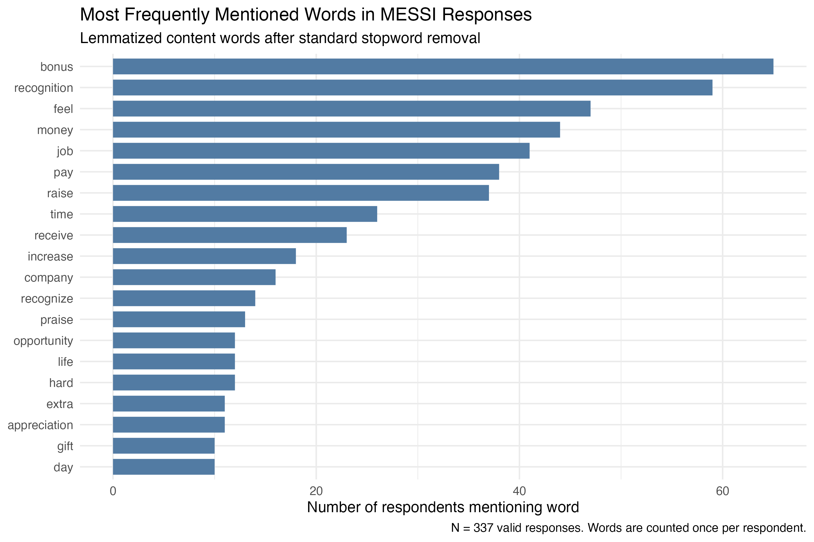
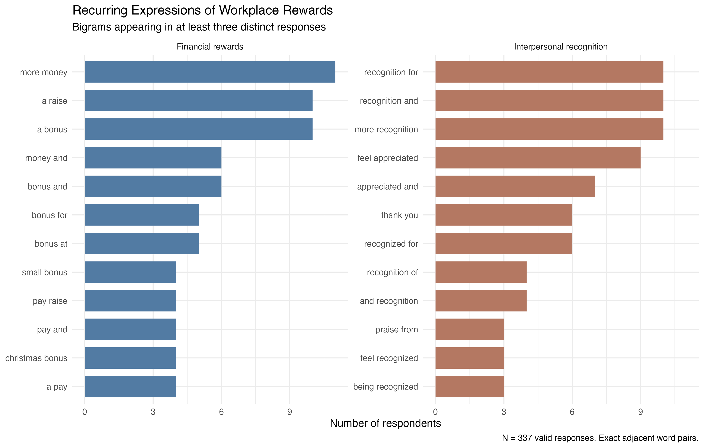
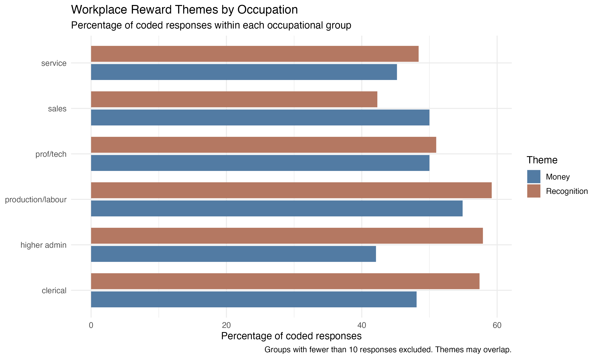
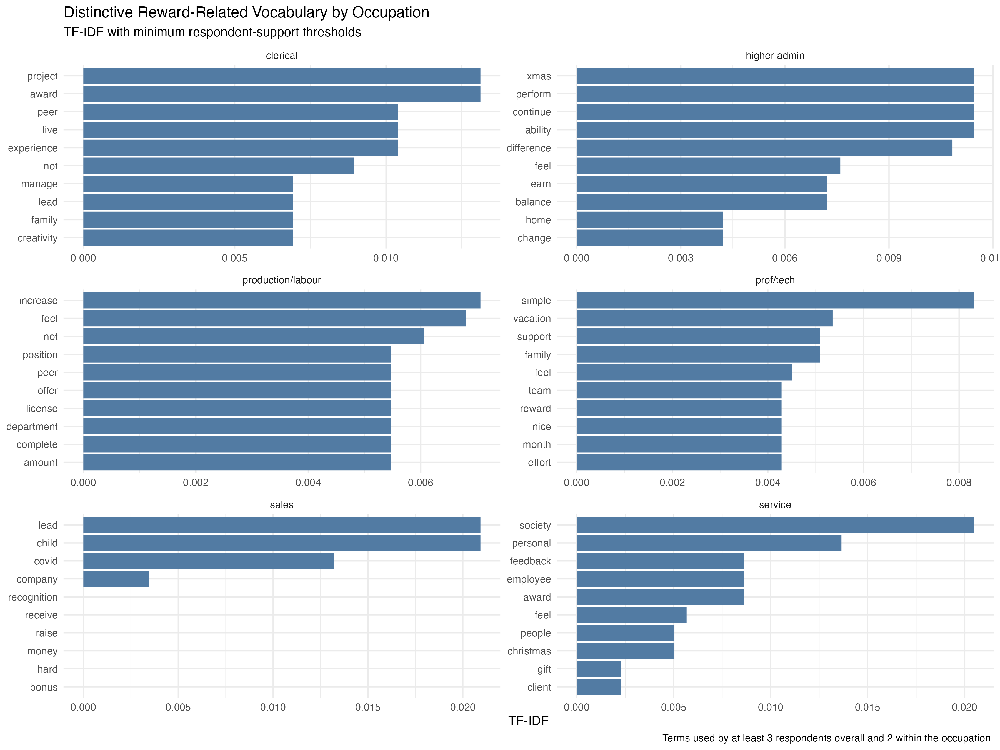

# Beyond Pay: Exploring Financial and Nonfinancial Recognition in Employee Narratives

## 1. Background and Research Question

This project revisits data from **Measuring Employment Sentiments and Social Inequality (MESSI)**, a research project I participated in as an undergraduate research assistant. Led by Professor Scott Schieman, MESSI uses nationally representative surveys conducted with YouGov and ARG to investigate workers' perceptions of their jobs, employment conditions, and social inequality. The project surveyed Canadian workers annually from 2024 to 2026 (8,828 respondents).

My previous work on MESSI involved reading open-ended survey responses and manually coding recurring themes. For this assignment, I wanted to revisit that process from an NLP perspective.

I selected responses to the following survey question:

> Has there ever been a time in your working life when you got **a little more** of something and it made a difference for how you felt about yourself or your job?

My central research question is:

**What forms of workplace rewards emerge in employees' narratives, how are financial and nonfinancial recognition related, and do these patterns vary across occupations?**

I also consider which NLP methods are useful for this particular kind of corpus: short, highly individualized survey responses.

## 2. Data and Preprocessing

The original corpus contained 340 open-ended responses from the Canadian MESSI survey. These are respondents who answered "Yes" to the question and voluntarily provided answers to the follow-up question asking them th After manually excluding three invalid responses, 337 remained, of which 323 had existing human-coded themes.

I first standardized the original coding categories, combining `acknowledgement` with `recognition` and assigning the ambiguous category `flexibility/socialization?` to `flexibility`. Because responses could have two theme labels, I preserved their multi-label structure.

For NLP, I tokenized the responses and applied lowercasing and lemmatization to combine grammatical variations, such as `bonus`/`bonuses` and `recognize`/`recognized`. I used English translations where available.

**A key preprocessing decision concerned stopwords.** The standard stopword list removed meaningful words such as `appreciate` and `thank`. After inspecting the affected responses, I customized the list to preserve these terms. I also retained the original unfiltered text for bigram and contextual analyses to avoid artificially changing word adjacency.

## 3. Human-Coded Themes: What Forms of Reward Matter?

I began with the existing human-coded themes to establish a conceptual baseline before examining individual words. This allowed me to compare broader qualitative interpretations with what automated lexical analysis would identify.

The two dominant themes were **Recognition (173 responses; 53.6% of coded responses)** and **Money (159; 49.2%)**.

Interestingly, 70 responses were coded with both themes. This suggests that financial rewards and interpersonal recognition are not necessarily separate or competing forms of reward.

Returning to selected responses, I noticed two recurring relationships: employees sometimes described financial rewards as making them feel recognized, while others valued financial compensation and interpersonal appreciation as complementary rewards.

This raises a broader interpretation: **financial compensation may carry both material value and symbolic meaning**, communicating that an employee's contribution is noticed and appreciated.

## 4. Unigram Analysis: What Language Do Employees Use?

Next, I calculated lemmatized word frequencies to examine whether the themes identified through human coding were also reflected in repeated vocabulary.

I counted both total word occurrences and the number of distinct respondents using each word, since repeated use by one respondent should not be mistaken for a widely shared concern.

The most widely used words included `bonus` (65 respondents), `recognition` (59), `feel` (47), `money` (44), `pay` (38), and `raise` (37).

These results broadly reinforced the human-coded findings: both financial compensation and interpersonal recognition were prominent in the corpus.

**Unigram analysis was especially useful for quickly grasping the overall content of the responses.** However, individual words do not capture complete concepts. For example, `bonus`, `pay`, and `raise` all relate to financial compensation, while `recognition`, `praise`, and `appreciation` can express similar nonfinancial experiences. Word frequencies also cannot determine whether a respondent is satisfied with a reward, dissatisfied, or simply describing an experience.

This motivated the next step: examining words in context.

## 5. Bigram Analysis: How Are Rewards Expressed?

I used bigrams to investigate whether common two-word expressions could provide more contextual information than individual words.

The bigram analysis largely reinforced the patterns identified in the unigram analysis, with financial compensation and interpersonal recognition remaining the two most prominent dimensions. Many frequently occurring bigrams simply combined substantive words with common grammatical words, offering limited additional information beyond individual word frequencies. Furthermore, 85.7% of distinct bigrams appeared in only one response, illustrating the sparsity of repeated expressions in this short-text corpus.

Nevertheless, several bigrams offered useful insights into how respondents understood and experienced different forms of reward.

For financial compensation, expressions such as "small bonus" and "Christmas bonus" added specificity to the broader category of monetary rewards. "Small bonus" raises the possibility that even relatively modest financial rewards can carry significance for employees, rather than their perceived value depending entirely on their monetary size. "Christmas bonus", meanwhile, identifies a recognizable occasion through which financial rewards may be provided. However, the recurrence of expressions such as "little more" suggests that the wording of the survey question may have influenced how respondents framed their answers, which should be considered when interpreting the apparent significance of smaller rewards.

For nonfinancial recognition, phrases such as "thank you" and "feel appreciated" point toward the interpersonal and subjective dimensions of recognition. "Thank you" illustrates that recognition may take relatively simple verbal forms rather than requiring formal awards or material incentives. Meanwhile, expressions involving "feel" suggest that recognition is not solely about whether acknowledgment is provided, but also about whether employees perceive themselves as being valued.

Taken together, these findings suggest that financial and nonfinancial rewards may be meaningfully distinct but not mutually exclusive. Financial rewards can communicate appreciation, while interpersonal recognition may carry significance independently of monetary value. The bigram analysis therefore contributes less by discovering new categories than by providing contextual detail about the forms and meanings of rewards already identified through unigram frequencies and human thematic coding.

## 6. Occupational Comparisons: Do Reward Patterns Differ by Type of Work?

I then compared the prevalence of Money and Recognition across occupations to explore whether different work contexts might be associated with different reward experiences.

Occupational groups with fewer than 10 respondents were excluded from subgroup comparisons. I calculated the percentage of coded respondents mentioning each theme rather than comparing raw counts, since occupational group sizes differed.

Recognition was more prevalent than Money in five of the six occupational groups, with Sales being the exception. The difference was particularly noticeable among Higher Administration respondents, while Professional/Technical respondents showed nearly equal proportions.

One possible explanation for the Sales pattern is that performance-based compensation, such as commissions, may create a more direct relationship between individual performance and financial rewards. Conversely, in other occupations, additional compensation may depend on more formal processes such as promotions or salary reviews.

For Higher Administration, the greater prevalence of Recognition raises the possibility that interpersonal acknowledgment remains important even in managerial and executive roles, where performance may be treated as an expectation rather than something explicitly recognized.

It's worth-noting that these explanations are hypotheses instead of conclusions. The differences are relatively modest, and the data do not establish respondents' actual compensation arrangements or how frequently they receive recognition. Overall, the consistency of Money and Recognition across occupational categories may be more notable than the differences.

## 7. TF--IDF: What Vocabulary Distinguishes Occupations?

Finally, I applied TF--IDF to explore vocabulary relatively distinctive to different occupational groups.

Because individual responses were very short, I aggregated them by occupation rather than treating each response as a separate document. I also applied minimum respondent-frequency thresholds to reduce the influence of words appearing in only one or two unusual responses.

The results were highly heterogeneous, and many distinctive words appeared connected to individual circumstances rather than broader occupational characteristics. This limited their interpretive value.

One potentially meaningful example emerged in the Service category, where `society` was relatively distinctive. Returning to the original responses revealed that some employees described recognition through acknowledgment of their contributions to society. This raises the possibility that perceived social impact forms part of what makes work rewarding for certain service employees.

However, this finding cannot be generalized to service workers as a whole.

TF--IDF also demonstrated that distinctiveness is not the same as importance: words such as `money` and `recognition` could receive low or zero scores precisely because they were shared across occupations.

For this corpus, TF--IDF was therefore more useful for **identifying vocabulary worth investigating qualitatively** than for establishing stable occupational differences.

## 8. Discussion and Conclusion

This exploration suggests that financial compensation and interpersonal recognition are two recurring, sometimes overlapping dimensions of workplace rewards. In particular, monetary rewards may function not only as economic benefits but also as acknowledgment of employees' contributions, while nonfinancial recognition may be conveyed through relatively simple interpersonal gestures.

Methodologically, the project changed how I think about applying NLP to qualitative survey data.

**Unigram analysis proved particularly efficient for obtaining a high-level understanding of the corpus.** With appropriate preprocessing, it identified recurring vocabulary that aligned with the original human-coded themes.

Bigrams and TF--IDF offered additional perspectives, but their usefulness was constrained by the structure of the data. Unlike longer documents with more comparable topics or writing contexts, these responses were short, discrete, and highly individualized. Even when employees discussed similar experiences, they often expressed them differently. Combined with relatively small occupational subgroups, this made exact phrase repetition and distinctive vocabulary less reliable indicators of broader patterns.

The most meaningful insights emerged when I **combined computational methods with contextual interpretation**. The original human coding helped identify broader concepts, while NLP made it easier to summarize the language, investigate recurring expressions, and identify potentially interesting differences.

A potential next step would be to build and validate an automated theme-classification pipeline using the existing human-coded responses as reference labels. This would extend the project from exploratory text analysis toward a more scalable approach to employee-feedback analysis.

Overall, this project illustrates both the potential and limitations of NLP for qualitative social research: computational techniques can make the exploration of open-ended responses more efficient, but interpreting human experiences still requires attention to context, a proper structure of the data and perhaps more sophisticated measurement choices.
